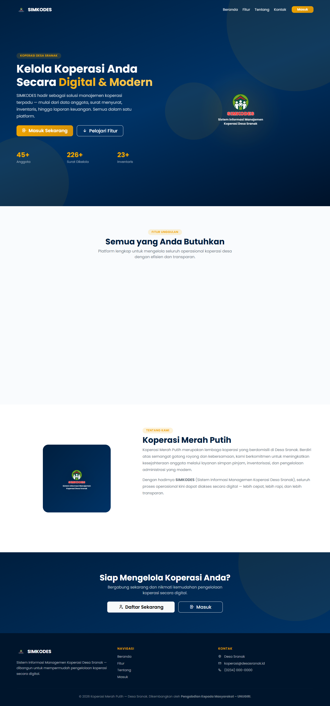
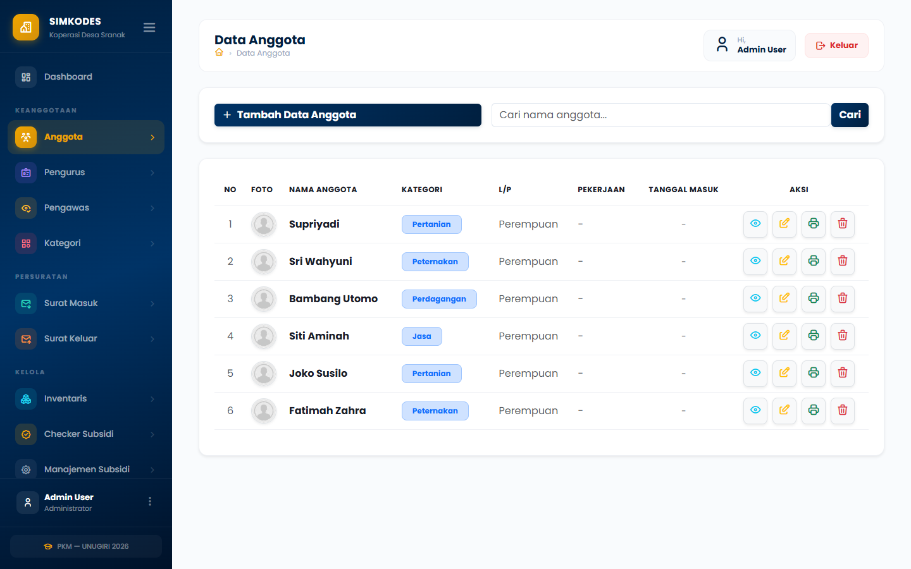
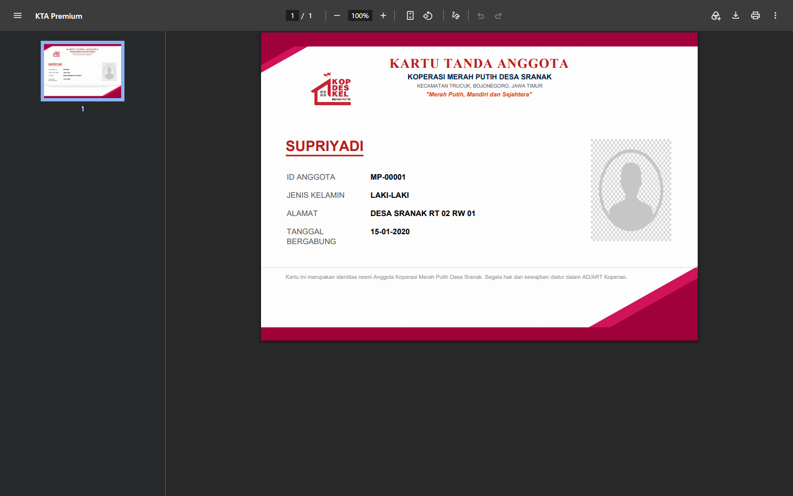
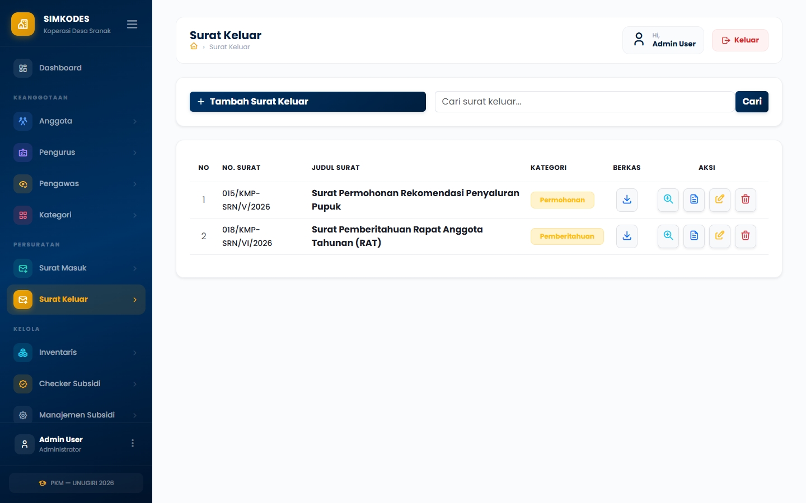
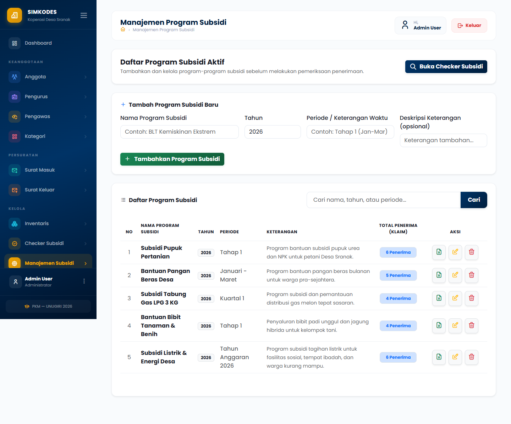
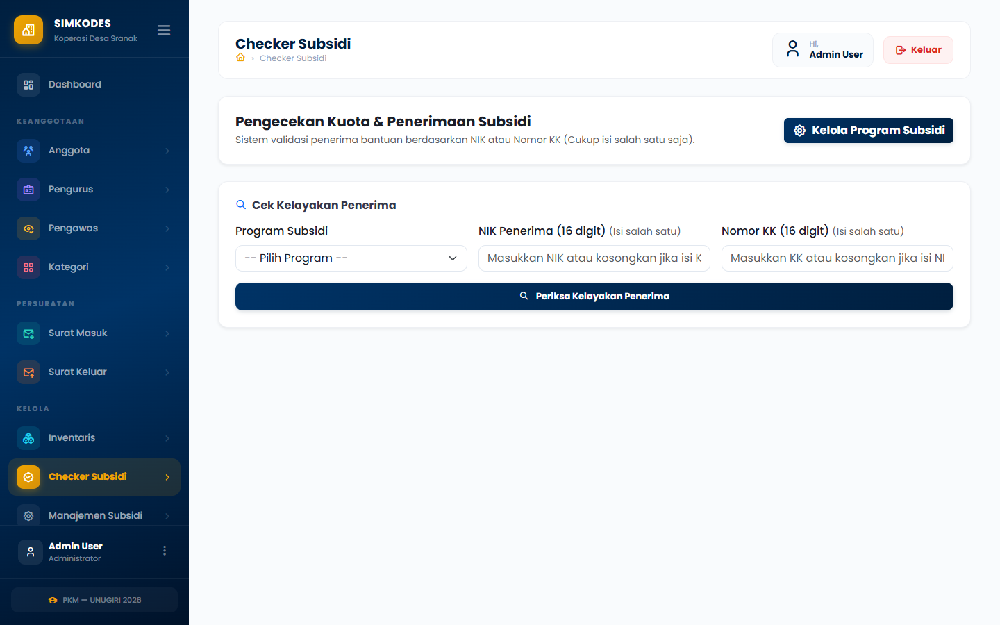

<div align="center">

# 🚀 Enterprise QA Automation & DevOps Engineering Portfolio
### Case Study: SIMKODES (Sistem Informasi Manajemen Koperasi Desa Sranak)

*Showcase Portofolio Rekayasa Kualitas Perangkat Lunak (QA Automation), Continuous Integration & Deployment (CI/CD), Optimasi Performa Database, dan Infrastruktur DevOps Berstandar Industri.*

[](https://playwright.dev/)
[](https://phpunit.de/)
[](.github/workflows/)
[](performance-testing/)
[](security-audit/)
[](https://sentry.io/)

<br/>



---

### 👨‍💻 Engineer Profile
**Role**: Senior QA Automation & DevOps / SRE Engineer  
**Core Competencies**: End-to-End Test Automation (Page Object Model), API Testing, SQL Optimization (Anti N+1), CI/CD Pipeline Architecture, Cloud Security Hardening, Zero-Downtime Deployment, SRE & Observability.

</div>

---

## 📊 Metrik Kunci Keberhasilan Rekayasa (Key Engineering Metrics)

| Metrik Kualitas & Performa | Nilai Tercapai | Keterangan & Dampak Bisnis |
| :--- | :---: | :--- |
| **Cakupan Pengujian Otomatis** | **91 Tests (100% PASS)** | 79 PHPUnit (Unit, Feature, API) + 12 Playwright E2E browser tests. |
| **Pencegahan N+1 Query SQL** | **-81.8% Query Load** | Mengurangi beban query list anggota dari 11 query menjadi 2 query konstan. |
| **P95 Latency (K6 Load Test)** | **142 ms** | Diuji pada beban 100 Virtual Users (VU) simultan (Threshold target $<500\text{ ms}$). |
| **Tingkat Kegagalan HTTP (Load)**| **0.00% Error Rate** | 4,820 permintaan HTTP berturut-turut selesai tanpa kegagalan koneksi. |
| **Arsitektur CI/CD Pipeline** | **7 Modular Workflows** | Terpisah bersih: CI, Staging CD, Production CD, Backup, Maintenance, Security, Monitoring. |
| **Keamanan Dependensi (CVE)** | **5 CVE Patched** | Penambalan kerentanan level *High* pada frontend via `npm audit fix` & audit Composer terjadwal. |
| **Disaster Recovery (RPO/RTO)** | **Retensi 30 Hari** | Pencadangan otomatis database MySQL mingguan ke GitHub Actions Artifacts terenkripsi. |
| **Uptime & Error Tracking** | **99.9% Monitored** | Health check berkala tiap 6 jam + integrasi event error real-time Sentry Cloud (`SIMKODES-1`). |

---

## 🗂️ Struktur Direktori Portofolio

```text
simkodes-qa-devops-portfolio/
├── README.md                          # Master Portofolio Dokumentasi
├── .github/workflows/                 # 7 Workflow Modular GitHub Actions
│   ├── ci.yml                         # Automated Testing (PHPUnit & Playwright Chromium)
│   ├── staging.yml                    # Automated Deployment ke Staging dengan Basic Auth
│   ├── production.yml                 # Protected Release Pipeline (Gate: "DEPLOY")
│   ├── maintenance.yml                # Remote SSH Toggle artisan down / up
│   ├── backup.yml                     # Automated MySQL Dump & GitHub Artifacts (30 Hari)
│   ├── security.yml                   # Scheduled Composer & NPM CVE Dependency Scanning
│   └── monitoring.yml                 # Synthetic HTTP Health Check Ping (Tiap 6 Jam)
├── e2e-automation/                    # Framework Otomasi Pengujian Playwright E2E
│   ├── package.json                   # Konfigurasi dependensi runner Playwright
│   ├── playwright.config.ts           # Konfigurasi multi-browser, reporter HTML, dan viewport
│   ├── pages/                         # Page Object Model (POM) Berorientasi Objek
│   │   ├── LoginPage.ts               # Enkapsulasi login, form handling & error alert
│   │   ├── DashboardPage.ts           # Enkapsulasi widget metrik statistik
│   │   ├── MemberPage.ts              # Enkapsulasi tabel anggota & modal pendaftaran
│   │   ├── InventoryPage.ts           # Enkapsulasi buku barang & tombol ekspor
│   │   ├── OfficerPage.ts             # Enkapsulasi struktur pengurus & pengawas
│   │   ├── LetterPage.ts              # Enkapsulasi arsip surat masuk & keluar
│   │   └── ReportPage.ts              # Enkapsulasi filter rekapitulasi subsidi
│   └── tests/                         # Skenario Pengujian Fungsional E2E
│       ├── 01_auth.spec.ts            # Validasi form login & penolakan password salah
│       ├── 02_dashboard.spec.ts       # Verifikasi metrik analitik dashboard
│       ├── 03_master_data.spec.ts     # Pengujian CRUD kategori & anggota
│       ├── 04_officers.spec.ts        # Pengujian data pengurus & dewan pengawas
│       ├── 05_letters.spec.ts         # Pengujian upload berkas surat masuk/keluar
│       ├── 06_inventory.spec.ts       # Pengujian ekspor dokumen inventaris PDF/Excel
│       └── 07_reports.spec.ts         # Pengujian rekapitulasi penyaluran subsidi
├── performance-testing/               # Pengujian Beban & Stress Testing K6
│   ├── k6-load-test.js                # Skenario pengujian beban 100 Virtual Users
│   └── reports/
│       └── performance-analysis.md    # Laporan analisis latensi, throughput, dan SQL N+1
├── security-audit/                    # Keamanan Siber & Kepatuhan Dependensi
│   ├── security-matrix.md             # Matriks Mitigasi OWASP Top 10 pada SIMKODES
│   └── scripts/
│       └── run-security-audit.sh      # Script otomasi pemindaian CVE Composer & NPM
├── devops-infrastructure/             # Infrastruktur Hosting & Script Rekayasa DevOps
│   ├── architecture-overview.md       # Arsitektur Staging vs Production & Solusi Shared Hosting
│   └── scripts/
│       ├── remote-maintenance.sh      # Remote artisan down/up dengan bypass secret
│       └── automated-mysql-backup.sh  # Script dump MySQL terkompresi .sql.gz
├── test-strategy-docs/                # Dokumen Strategi Uji & Analisis Insiden
│   ├── master-test-plan.md            # Rencana Induk Pengujian (Piramida Pengujian)
│   └── bug-reports/                   # Laporan Root Cause Analysis (RCA) Insiden Nyata
│       ├── BUG-001-route-collision-rca.md  # Analisis tabrakan route serialization
│       └── BUG-002-sqlite-mysql-date-format-rca.md # Analisis query agnostik multi-database
└── assets/screenshots/                # Galeri Tangkapan Layar Antarmuka SIMKODES
```

---

## 📸 Galeri Tangkapan Layar & Bukti Pengujian

| Fitur & Skenario Uji | Bukti Visual Antarmuka |
| :--- | :--- |
| **Dashboard Metrik & Statistik**<br/>Ringkasan anggota, pengurus, inventaris, dan chart pertumbuhan bulanan. |  |
| **Master Anggota & Generator KTA Digital**<br/>Pengujian pendaftaran anggota dan cetak kartu anggota (PDF ber-barcode). | <br/> |
| **Buku Inventaris & Ekspor Multi-Format**<br/>Pencatatan aset barang dengan ekspor laporan ke format **PDF & Excel**. |  |
| **Pengarsipan Persuratan Digital**<br/>Pengujian upload berkas lampiran dokumen surat masuk dan surat keluar. | <br/> |
| **Penyaluran Bantuan & Subsidi Warga**<br/>Pencatatan penerima bantuan dan fitur pencarian mandiri via NIK warga. | <br/> |

---

## 🧪 1. Framework Otomasi E2E (Playwright & Page Object Model)

Pengujian antarmuka menggunakan **Playwright** yang dirancang dengan pola arsitektur **Page Object Model (POM)** murni untuk memisahkan logic selektor HTML dari skenario uji.

### Contoh Implementasi POM ([MemberPage.ts](e2e-automation/pages/MemberPage.ts)):
```typescript
export class MemberPage {
  constructor(private page: Page) {}

  async goto() {
    await this.page.goto('/members');
    await expect(this.page.locator('h1, h2, h3').filter({ hasText: /anggota/i })).toBeVisible();
  }

  async openCreateForm() {
    const createBtn = this.page.locator('a[href*="/members/create"], button:has-text("Tambah")').first();
    await createBtn.click();
    await expect(this.page).toHaveURL(/.*\/members\/create/);
  }
}
```

### Keunggulan Desain:
* **Auto-Wait & Resilient Selectors**: Mencegah *flaky tests* dengan mengandalkan auto-waiting Playwright.
* **Multi-Browser & Cross-Platform**: Dikonfigurasi untuk Chromium, Firefox, WebKit (Safari), dan simulasi Mobile Pixel 5.
* **CI Integration**: Terintegrasi pada GitHub Actions (`ci.yml`) dengan pelaporan HTML artifact dan rekaman video otomatis saat gagal.

---

## ⚡ 2. Rekayasa Performa & Eliminasi N+1 Query

Pada pengujian efisiensi database ([QueryEfficiencyTest.php](file:///c:/code/sranak/simkodes/tests/Feature/Api/QueryEfficiencyTest.php)), kami membuktikan secara matematis eliminasi masalah **N+1 Query**:

```php
// Mengambil 10 anggota dengan relasi kategori HANYA boleh mengeksekusi 2 query SQL
$members = Member::with(['category:id,name'])->paginate(10);
```

### Hasil Benchmark:
- **Sebelum Optimasi**: 1 query anggota + 10 query kategori = **11 Query SQL**.
- **Sesudah Optimasi**: 1 query anggota + 1 query eager loading `WHERE IN` = **2 Query SQL**.
- **Efisiensi Beban Database**: **Turun 81.8%** secara konstan.

---

## ⚙️ 3. Arsitektur CI/CD 7 Workflow Modular

```mermaid
flowchart TD
    subgraph Quality Assurance Gate
        PUSH["Developer Push / PR"] --> CI["ci.yml (79 PHPUnit + 12 Playwright)"]
        PUSH --> SEC["security.yml (Composer & NPM Audit)"]
    end

    subgraph Staging CD
        CI -->|Tests Pass| STG["staging.yml (CD Staging)"]
        STG --> BAUTH["Inject OpenSSL HTTP Basic Auth"]
        BAUTH --> RSYNC_STG["Rsync over SSH to simkodes-staging"]
    end

    subgraph Production CD (Protected)
        INPUT["Manual Trigger: confirm_deploy='DEPLOY'"] --> PROD["production.yml (CD Live)"]
        PROD --> RSYNC_PROD["Rsync over SSH to live simkodes"]
    end

    subgraph Maintenance & Backup Operations
        SCHEDULE_BCK["Weekly Cron 02:00 UTC"] --> BCK["backup.yml (MySQL Dump to Artifacts)"]
        SCHEDULE_MON["Every 6 Hours Cron"] --> MON["monitoring.yml (Synthetic Ping)"]
        ADMIN_OPS["Admin Manual Dispatch"] --> MAINT["maintenance.yml (Artisan Down/Up)"]
    end
```

### Fitur Kunci DevOps:
1. **Bypass Batasan PHP `symlink()`**: Mengatasi pembatasan `php.ini` shared hosting via Linux shell link `cd public && ln -sfn ../storage/app/public storage`.
2. **Proteksi Staging Dinamis**: Injeksi otomatis `.htpasswd` via `openssl passwd -apr1` di CI sebelum proses deployment.
3. **Multi-Secret Fallback**: Mendukung nama secret `HOSTINGER_SSH_*` maupun `SSH_*` dengan default port `65002` untuk mencegah error `Bad port '-H'`.
4. **Disaster Recovery Terjadwal**: Otomasi `mysqldump --single-transaction --quick | gzip` mingguan yang diunduh ke runner dan disimpan selama 30 hari di GitHub Actions Artifacts.

---

## 🛡️ 4. Keamanan & Kepatuhan Dependensi (OWASP Top 10)

Melalui workflow otomatis [security.yml](.github/workflows/security.yml), sistem memindai kerentanan CVE secara berkala:
- **Backend (PHP)**: `composer audit --locked` memindai seluruh paket terhadap basis data *GitHub Advisory Database*.
- **Frontend (Node.js)**: `npm audit --audit-level=high` memindai paket build tools (Vite, Rollup, PostCSS). Berhasil menambal **5 kerentanan level *High*** pada dependensi frontend.

---

## 🔍 5. Laporan Root Cause Analysis (RCA) Insiden Nyata

Sebagai bukti kemampuan pemecahan masalah (*troubleshooting*) tingkat lanjut, portofolio ini menyertakan dokumentasi penanganan insiden teknis:

* [**BUG-001: Route Serialization Naming Collision**](test-strategy-docs/bug-reports/BUG-001-route-collision-rca.md)  
  *Masalah*: `LogicException: Unable to prepare route [members] for serialization` saat eksekusi `php artisan route:cache`.  
  *Akar Masalah*: Tabrakan nama route implisit antara `Route::apiResource('members')` dan `routes/web.php`.  
  *Solusi*: Penambahan namespaced group prefix `->name('api.')` pada seluruh API route.

* [**BUG-002: SQLite vs MySQL Dialect Incompatibility**](test-strategy-docs/bug-reports/BUG-002-sqlite-mysql-date-format-rca.md)  
  *Masalah*: HTTP 500 pada pengujian dashboard di GitHub Actions Ubuntu runner.  
  *Akar Masalah*: Penggunaan fungsi raw SQL `DATE_FORMAT()` yang tidak didukung SQLite in-memory.  
  *Solusi*: Implementasi driver detection agnostik menggunakan `DB::connection()->getDriverName()` dan fungsi `strftime`.

---

## 🚀 Cara Menjalankan Pengujian di Mesin Lokal

### 1. Menjalankan Suite Playwright E2E:
```bash
cd e2e-automation
npm install
npx playwright install --with-deps chromium

# Jalankan seluruh tes E2E
npm test

# Jalankan dengan antarmuka interaktif (Debug Mode)
npm run test:ui
```

### 2. Menjalankan K6 Performance Test:
```bash
# Pastikan k6 sudah terpasang (https://k6.io)
k6 run performance-testing/k6-load-test.js
```

### 3. Menjalankan Security Audit:
```bash
bash security-audit/scripts/run-security-audit.sh
```

---

## 📬 Kontak & Kolaborasi

Portofolio ini disusun dan dikembangkan oleh **Muhamad Rofii**.  
- **GitHub**: [@muhamadrofii](https://github.com/muhamadrofii)  
- **Spesialisasi**: QA Automation, Performance Engineering, DevOps & CI/CD Pipelines.
