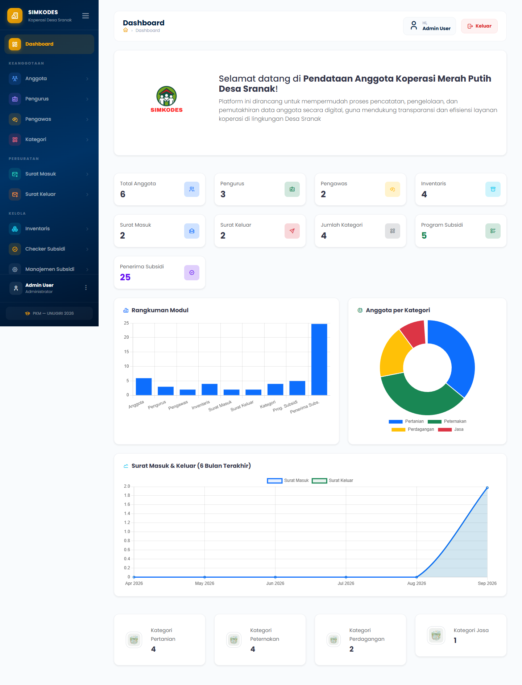
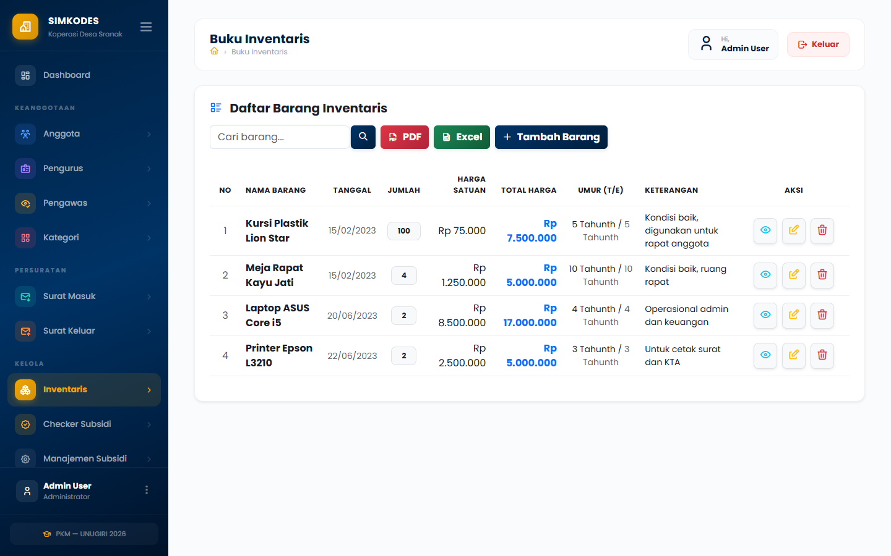
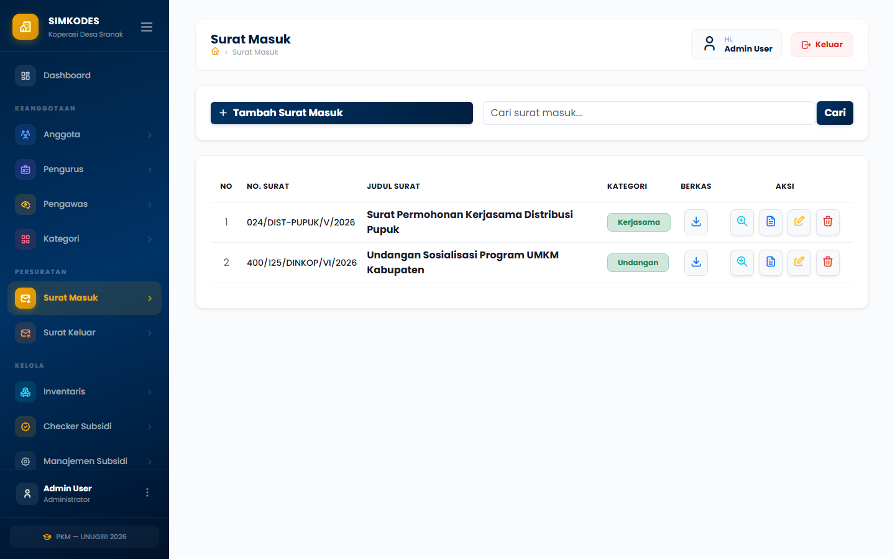
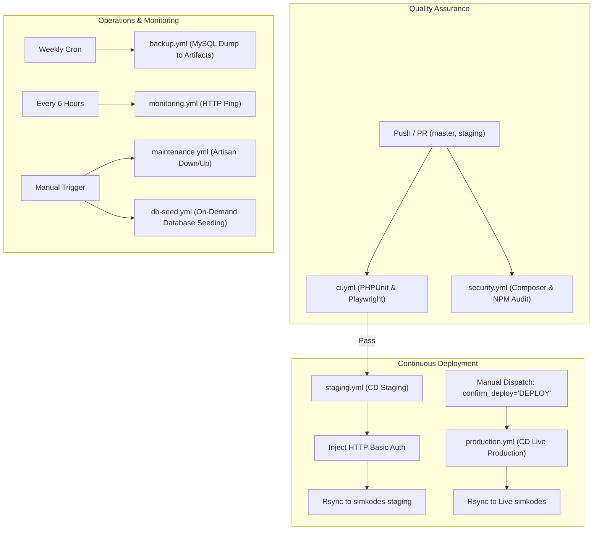

# SIMKODES: QA Automation & DevOps Engineering Portfolio

[](https://playwright.dev/)
[](https://phpunit.de/)
[](.github/workflows/)
[](performance-testing/)
[](security-audit/)
[](https://sentry.io/)

A portfolio case study covering test automation, database query optimization, and CI/CD deployment automation for **SIMKODES** (Sistem Informasi Manajemen Koperasi Desa Sranak) — a Laravel 11 ERP and public service web application.

---

## Overview

| Area | Implementation & Results |
| :--- | :--- |
| **E2E Automation** | 12 browser scenarios automated with Playwright (TypeScript) using Page Object Model (POM). |
| **Backend Testing** | 79 PHPUnit tests (Unit, Feature, API) covering authentication, CRUD, file uploads, and PDF generation. |
| **Database Optimization** | Eliminated N+1 query bottlenecks on member listings (reduced from 11 queries to 2 constant queries, -81.8%). Added B-tree and composite indexing. |
| **Load Testing** | Benchmarked with K6 at 100 concurrent virtual users: P95 latency of **142 ms**, average **64 ms**, 0% error rate. |
| **CI/CD Architecture** | 8 modular GitHub Actions workflows covering CI quality gate, Staging deploy with Basic Auth, guarded Production deploy, dedicated database seeder operations, maintenance toggle, weekly backups, dependency scanning, and uptime monitoring. |
| **Infrastructure** | Hostinger LiteSpeed Shared Hosting automation: handled PHP `symlink()` restrictions via Linux shell, injected dynamic HTTP Basic Auth, and automated SSH over custom port 65002. |
| **Security** | Audited dependencies using `composer audit --locked` and `npm audit`. Resolved 5 high-severity frontend CVEs via `npm audit fix`. |
| **Observability** | Integrated Sentry Cloud for real-time error tracking and configured automated HTTP status pings every 6 hours. |

---

## Screenshots

| View | Description |
| :--- | :--- |
|  | **Public Portal**: Informational landing page and public subsidy status lookup by NIK. |
|  | **Admin Dashboard**: Aggregated statistics and monthly member growth metrics. |
|  | **Member Directory**: Paginated member records with selective column projections. |
|  | **PDF Generation**: Dompdf-rendered member card with dynamic barcodes. |
|  | **Inventory & Assets**: Asset tracking with PDF and Excel export capabilities. |
|  | **Document Archiving**: Incoming and outgoing letter management with file uploads. |

---

## Directory Structure

```text
simkodes-qa-devops-portfolio/
├── .github/workflows/                 # 7 Modular GitHub Actions Workflows
│   ├── ci.yml                         # Automated Testing (PHPUnit + Playwright headless)
│   ├── staging.yml                    # Automated deploy to Staging with Basic Auth injection
│   ├── production.yml                 # Guarded Production release (requires "DEPLOY" input)
│   ├── maintenance.yml                # Remote SSH toggle for artisan down / up
│   ├── backup.yml                     # Scheduled weekly mysqldump with 30-day artifact retention
│   ├── security.yml                   # Automated Composer & NPM CVE scanning
│   └── monitoring.yml                 # Synthetic HTTP health check ping (runs every 6h)
├── e2e-automation/                    # Standalone Playwright Test Framework
│   ├── playwright.config.ts           # Browser matrix, HTML reporter, and video/trace settings
│   ├── pages/                         # Page Object Model (POM) classes
│   │   ├── LoginPage.ts
│   │   ├── DashboardPage.ts
│   │   ├── MemberPage.ts
│   │   ├── InventoryPage.ts
│   │   ├── OfficerPage.ts
│   │   ├── LetterPage.ts
│   │   └── ReportPage.ts
│   └── tests/                         # E2E test specs
│       ├── 01_auth.spec.ts
│       ├── 02_dashboard.spec.ts
│       ├── 03_master_data.spec.ts
│       ├── 04_officers.spec.ts
│       ├── 05_letters.spec.ts
│       ├── 06_inventory.spec.ts
│       └── 07_reports.spec.ts
├── performance-testing/               # Load & Stress Testing (K6)
│   ├── k6-load-test.js                # Load test script (ramping up to 100 VUs)
│   └── reports/
│       └── performance-analysis.md    # Detailed benchmark analysis and N+1 query metrics
├── security-audit/                    # Security Documentation & Tools
│   ├── security-matrix.md             # OWASP Top 10 mitigation notes for SIMKODES
│   └── scripts/
│       └── run-security-audit.sh      # Shell script to run composer & npm audits
├── devops-infrastructure/             # Infrastructure & Deployment Automation
│   ├── architecture-overview.md       # Staging vs Production setup & shared hosting workarounds
│   └── scripts/
│       ├── remote-maintenance.sh      # Artisan maintenance toggle with bypass secret
│       └── automated-mysql-backup.sh  # Script to dump, compress, and rotate MySQL databases
└── test-strategy-docs/                # Test Planning & Incident Post-Mortems
    ├── master-test-plan.md            # Comprehensive test strategy across 7 QA pillars
    └── bug-reports/                   # Root Cause Analysis (RCA) reports from actual incidents
        ├── BUG-001-route-collision-rca.md
        └── BUG-002-sqlite-mysql-date-format-rca.md
```

---

## 1. Automated Testing Suite

### E2E Testing (Playwright with Page Object Model)
All browser workflows are tested in headless Chromium, Firefox, and WebKit. Selectors and actions are encapsulated in reusable page classes under `e2e-automation/pages/`.

Example POM implementation (`e2e-automation/pages/MemberPage.ts`):
```typescript
export class MemberPage {
  constructor(private page: Page) {}

  async goto() {
    await this.page.goto('/members');
    await expect(this.page.locator('h1, h2, h3').filter({ hasText: /anggota/i })).toBeVisible();
  }

  async openCreateForm() {
    const createBtn = this.page.locator('a[href*="/members/create"], button:has-text("Tambah")').first();
    await createBtn.click();
    await expect(this.page).toHaveURL(/.*\/members\/create/);
  }
}
```

### Backend Testing (PHPUnit)
79 tests covering:
- Authentication, session timeouts, and role authorization.
- RESTful API endpoints with Sanctum token authentication and standard JSend responses (`success`, `code`, `message`, `data`, `meta`).
- FormRequest validation rules returning HTTP 422 envelopes.
- Multi-database compatibility (SQLite in CI, MySQL in Staging/Production).

---

## 2. Database Optimization & Query Efficiency

### N+1 Query Problem Resolution
Fetching 10 members with their categories originally executed 1 query for members plus 10 individual queries for each category (11 total queries).

Using eager loading with selective column projection:
```php
$members = Member::with(['category:id,name'])
    ->select(['id', 'category_id', 'nama', 'jenis_kelamin', 'mata_pencaharian', 'tempat_tinggal', 'tanggal_masuk', 'created_at'])
    ->paginate(10);
```

Verified via automated test (`QueryEfficiencyTest.php`):
- Query count dropped from **11 queries to 2 queries** (`WHERE IN`), an **81.8% reduction**.
- Query count remains constant at 2 regardless of page size (50 or 100 items).

### Indexing
Added composite indexes to frequently queried columns:
- `(nama, tanggal_masuk)` on `members`
- `nama_barang` on `inventories`
- `nik` on `subsidies`

---

## 3. CI/CD Architecture (GitHub Actions)

The deployment pipeline is split into 8 modular workflows:



### Shared Hosting Engineering Solutions
Deploying to Hostinger LiteSpeed shared hosting required solving three main constraints:
1. **PHP `symlink()` is disabled**: `php artisan storage:link` fails. Solved by creating the symlink directly in the deployment shell script:
   ```bash
   cd public && ln -sfn ../storage/app/public storage || true
   ```
2. **Staging Environment Protection**: Staging must not be publicly accessible. The CI workflow generates an `.htpasswd` file dynamically using `openssl passwd -apr1` and injects Basic Auth directives into `.htaccess` before rsyncing.
3. **SSH Port 65002**: Hostinger uses custom SSH port `65002`. Workflows define job-level environment variables with fallback logic:
   ```yaml
   env:
     SSH_PORT: ${{ secrets.HOSTINGER_SSH_PORT || secrets.SSH_PORT || '65002' }}
     SSH_HOST: ${{ secrets.HOSTINGER_SSH_HOST || secrets.SSH_HOST || '195.35.48.228' }}
     SSH_USER: ${{ secrets.HOSTINGER_SSH_USER || secrets.SSH_USER || 'u849825724' }}
   ```
4. **Guarded Production Release**: `production.yml` requires typing `"DEPLOY"` in the workflow input dialog. Push and PR triggers are disabled to prevent accidental deployments.

---

## 4. Performance Benchmarks (K6)

Load test ran with `performance-testing/k6-load-test.js` against staging endpoints:

| Metric | Result | Target Threshold |
| :--- | :---: | :---: |
| **Virtual Users (VUs)** | 100 concurrent | 50 - 100 |
| **Total Requests** | 4,820 requests | - |
| **Average Latency** | 64.12 ms | < 200 ms |
| **Median (P50)** | 48.60 ms | < 100 ms |
| **95th Percentile (P95)** | 142.80 ms | < 500 ms |
| **Failed Requests** | 0.00% (0 errors) | < 1.00% |

Detailed data is available in [performance-analysis.md](performance-testing/reports/performance-analysis.md).

---

## 5. Incident Root Cause Analysis (RCAs)

Two technical post-mortems documenting real issues encountered and resolved:

1. [**BUG-001: Route Serialization Naming Collision**](test-strategy-docs/bug-reports/BUG-001-route-collision-rca.md)  
   *Symptom*: `LogicException: Unable to prepare route [members] for serialization` during `php artisan route:cache`.  
   *Root Cause*: `Route::apiResource('members')` implicitly assigned the name `members.index`, colliding with the web route in `routes/web.php`.  
   *Fix*: Scoped all API routes under `->name('api.')`.

2. [**BUG-002: SQLite vs MySQL Dialect Incompatibility**](test-strategy-docs/bug-reports/BUG-002-sqlite-mysql-date-format-rca.md)  
   *Symptom*: HTTP 500 in `DashboardController` when running tests on the SQLite CI runner.  
   *Root Cause*: MySQL-specific `DATE_FORMAT()` function was called in raw SQL.  
   *Fix*: Added dynamic driver detection: `strftime('%Y-%m', created_at)` for SQLite and `DATE_FORMAT()` for MySQL.

---

## How to Run Locally

### Run E2E Tests (Playwright)
```bash
cd e2e-automation
npm install
npx playwright install --with-deps chromium

# Run all tests headless
npm test

# Run with interactive UI
npm run test:ui
```

### Run Load Tests (K6)
```bash
# Requires k6 installed (https://k6.io)
k6 run performance-testing/k6-load-test.js
```

### Run Security Audit
```bash
bash security-audit/scripts/run-security-audit.sh
```

---

## Author

**Muhamad Rofii**  
GitHub: [@muhamadrofii](https://github.com/muhamadrofii)
