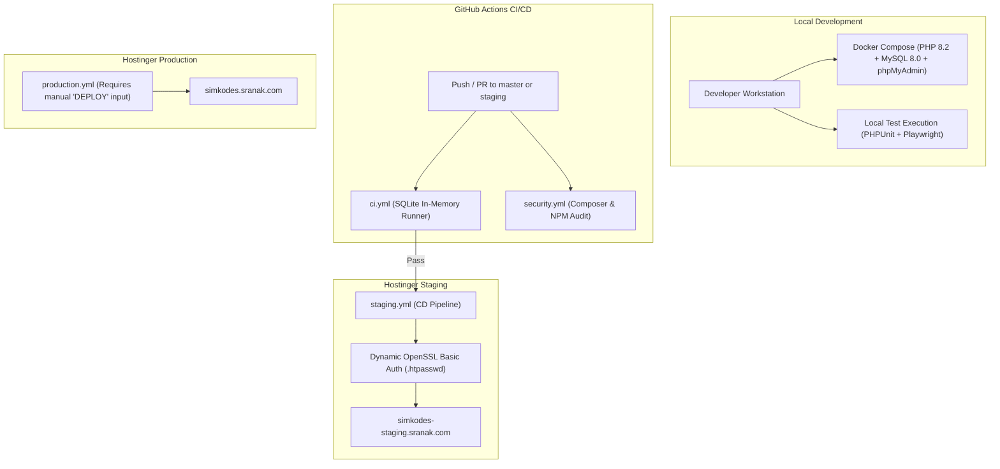

# DevOps Infrastructure & Shared Hosting Workarounds

**System**: SIMKODES (Sistem Informasi Manajemen Koperasi Desa Sranak)  
**Target Environment**: Hostinger LiteSpeed Shared Hosting  
**Maintainer**: Muhamad Rofii  

---

## 1. Environment Architecture

The deployment topology uses three distinct environments: Local development, Staging for pre-production verification, and Live Production.



---

## 2. Shared Hosting Constraints & Technical Workarounds

Hostinger shared hosting runs on LiteSpeed Enterprise without root access, custom daemons, or container runtimes. The following technical workarounds were implemented:

### A. Storage Symlink Workaround
* **Constraint**: Hostinger disables `symlink()` in `php.ini` for security reasons. Running `php artisan storage:link` throws `Call to undefined function Illuminate\Filesystem\symlink()`.
* **Fix**: The CI/CD post-deployment script creates the symlink directly via the Linux shell over SSH:
  ```bash
  cd public && ln -sfn ../storage/app/public storage || true
  ```
  This creates the symbolic link at the OS filesystem level without invoking PHP's disabled function.

### B. Dynamic HTTP Basic Auth on Staging
* **Constraint**: The staging site must be restricted from public access and search engine crawlers without hardcoding plaintext credentials in Git.
* **Fix**: The `staging.yml` workflow generates an Apache-compatible `.htpasswd` file using OpenSSL before rsyncing:
  ```bash
  HTPASSWD_HASH=$(openssl passwd -apr1 "${{ secrets.STAGING_AUTH_PASS }}")
  echo "${{ secrets.STAGING_AUTH_USER }}:${HTPASSWD_HASH}" > public/.htpasswd
  sed -i "1i AuthType Basic\nAuthName \"Restricted Staging Access\"\nAuthUserFile /home/u849825724/domains/sranak.com/public_html/simkodes-staging/public/.htpasswd\nRequire valid-user\n" public/.htaccess
  ```

### C. SSH Port 65002 & Secret Fallback
* **Constraint**: Hostinger uses port `65002` for SSH connections. Missing or inconsistently named GitHub secrets can cause `ssh-keyscan` to fail with `Bad port '-H'`.
* **Fix**: Workflows declare job-level environment variables with fallback values:
  ```yaml
  env:
    SSH_PORT: ${{ secrets.HOSTINGER_SSH_PORT || secrets.SSH_PORT || '65002' }}
    SSH_HOST: ${{ secrets.HOSTINGER_SSH_HOST || secrets.SSH_HOST || '195.35.48.228' }}
    SSH_USER: ${{ secrets.HOSTINGER_SSH_USER || secrets.SSH_USER || 'u849825724' }}
  ```
  This ensures `ssh-keyscan` always receives a valid port integer and host string.

---

## 3. Environment Matrix

| Parameter | Staging Environment | Production Environment |
| :--- | :--- | :--- |
| **URL** | `https://simkodes-staging.sranak.com` | `https://simkodes.sranak.com` |
| **Server Directory** | `/home/u849825724/domains/sranak.com/public_html/simkodes-staging/` | `/home/u849825724/domains/sranak.com/public_html/simkodes/` |
| **Access Control** | HTTP Basic Auth (`.htpasswd`) | Public & Authenticated Users |
| **Release Trigger** | Automatic on push to `master` or `staging` | Manual `workflow_dispatch` with confirmation input `"DEPLOY"` |
| **Database** | `u849825724_simkodes_staging` | `u849825724_simkodes_prod` |
| **Optimization** | `php artisan optimize` | `php artisan optimize` |
